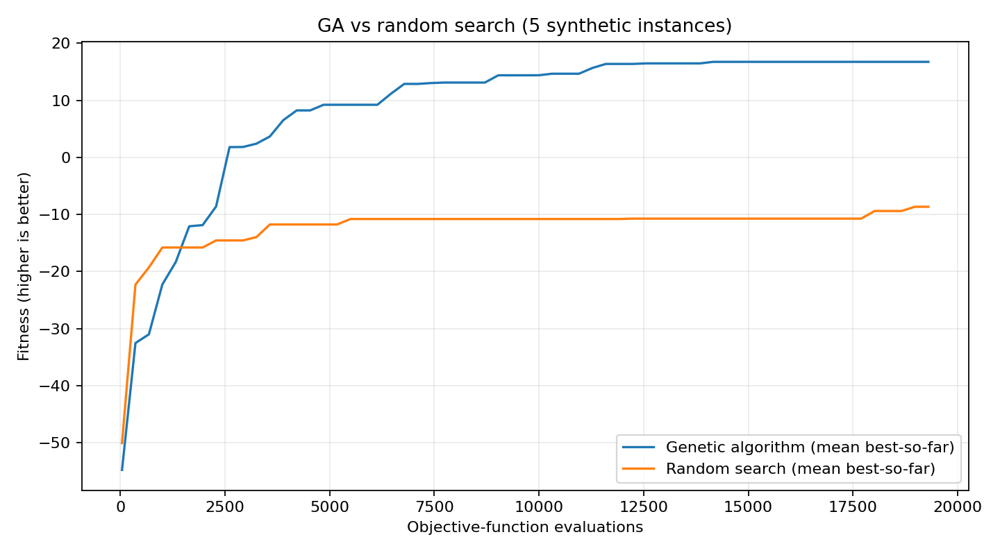

# Evolutionary Assignment Optimizer 🧬

A **standalone Python reimplementation** inspired by a university group software project about organizing collaborative cooking events. This repo is a new educational experiment, **not** a port or redistribution of the original team's source code or datasets.

It uses a **genetic algorithm** to assign synthetic event participants into fixed-size groups, balancing proximity, shared interests, age differences, and a simple dietary-compatibility penalty.

## Algorithms

- **Representation:** permutation of participant indices; every person is assigned exactly once.
- **Fitness:** weighted pairwise compatibility across all groups. Higher is better; weights are illustrative, not calibrated.
- **Selection:** tournament selection.
- **Crossover:** order crossover (OX), keeping valid permutations.
- **Mutation:** swap two participant positions.
- **Elitism:** retain top-scoring chromosomes each generation.
- **Baseline:** one random grouping produced from the same synthetic population.

This is a toy grouping benchmark, **not a full implementation of cooking-event scheduling**, and does not enforce real allergy or food-safety constraints. Dietary compatibility is only modeled as a soft penalty.

## Quick start

Requires Python 3.10+.

```bash
python -m pip install -e '.[dev]'
python -m evo_assignment --participants 24 --group-size 3 --generations 160 --seed 42
pytest -q
```

Writes `results/participants.csv`, `results/groups.csv`, and `results/convergence.csv`. The CSV participants are generated randomly, not copied from the original project.

Example parameter variations:

```bash
python -m evo_assignment --participants 30 --group-size 3 --generations 250 --seed 7 --output results/run7
```

Participant count must be divisible by group size. Use the `--seed` flag to reproduce an experiment. The tool deliberately uses only Python's standard library at runtime.

## Objective

For each pair of people assigned to the same group, compute

`3 × shared interests − distance − 0.04 × age gap − 15 × incompatible-diet flag`.

The overall score is the sum over all within-group pairs. Distances are Euclidean distances on an **artificial coordinate plane** (not kilometers). The diet flag applies only when both participants are non-omnivores with differing diets. This heuristic is deliberately simplified and should not be used to make actual accessibility or dietary-safety decisions.

## Reproducible benchmark and convergence plots

Install visualization dependencies and run **five independent synthetic instances**:

```bash
python3 -m pip install -e '.[dev]'
python3 -m evo_assignment.benchmark
```

This produces:

- `results/benchmark/convergence.png` — GA and random-search **mean best-so-far fitness**, plotted against objective-function evaluations.
- `results/benchmark/trials.csv` — per-seed final scores and evaluation counts.
- `results/benchmark/convergence.csv` — per-seed learning curves for independent analysis.

Customize with `--trials 10 --population 40 --generations 60 --participants 18`.

Example output from the default five-trial benchmark:



**Fairness and limits:** Both algorithms solve the **same synthetic instance** in a given trial and each receives an **identical number of fitness-function evaluations**. Random search evaluates independently sampled permutations and keeps the best; GA includes every fitness call, even repeats during tournament selection and sorting. Random number streams are independent. GA computation also incurs overhead not represented by the fitness-evaluation budget; this is *not* a wall-clock speed comparison. Dataset instances differ across seeds. Small sample sizes and a single objective do not establish general algorithmic superiority.

## Ideas for extension

- Add a greedy local-search baseline and evaluate statistical uncertainty across more trials.
- Introduce hard constraints via repair/feasibility operators.
- Add multi-objective optimization and Pareto-front visualization.
- Add parameter sweeps for population size and mutation rate.
- Extend from independent groups to a multi-course host-and-guest assignment problem.

## Provenance

This project is an independent Python implementation inspired by a collaborative university software engineering project, using newly written code and synthetic data. The original group project remains separate; its source code, datasets, and other contributors' work are not included here.

## License

This project is licensed under the MIT License. See the [LICENSE](LICENSE) file for details.
